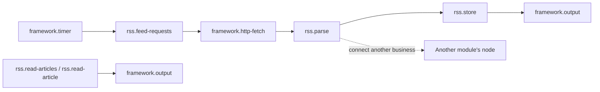

# Streaming pipelines and RSS example

English | [中文](streaming-mvp.zh.md)

## Purpose and scope

This version uses an RSS reader to explore streaming nodes that can connect across business modules. Framework and business code compile separately. The schema serves this implementation without introducing another database design standard. Interaction currently uses the CLI, in-process APIs, and generated HTTP clients; there is no ComfyUI-style visual editor yet.

## Framework and business

| Part | Responsibility |
| - | - |
| [Framework](../../src/LazyTuiHub.Framework/) | Data references and relationships, pipeline definitions, node registration, bounded queues, execution, and cancellation; includes timer, HTTP fetch, and output nodes. |
| [RSS](../../src/LazyTuiHub.Rss/) | Subscriptions, RSS 2.0/Atom parsing, article storage, queries, and read state; integrates through registered nodes. |
| [Host](../../src/LazyTuiHub/) | Module composition, CLI, background refresh, and transport adaptation. Application services execute business operations through pipelines. |
| [API](../../src/LazyTuiHub.Api/Protos/lazytuihub/rss/v1/rss_service.proto) | Proto describes interfaces and behavior, generating OpenAPI, HTTP clients, and the English reference. |

The framework maintains two kinds of relationships. Nodes and connections in PipelineDefinition represent processing relationships; DataReference and DataRelation represent associations between persistent data. RSS registers subscriptions and articles as rss.feed and rss.article objects, connected by contains relationships. Business fields live in RSS-owned tables; article writes and generic relationships commit in the same SQLite transaction. The catalog does not retain every execution event or another copy of each payload.

## Ingestion and reading



rss.ingest is the ingestion graph. rss.feeds, rss.articles, and rss.article are reading graphs; subscription creation and marking articles read also execute through nodes. HTTP and local calls share IRssApi and the application service. The HTTP boundary serializes messages while service internals continue passing object references. See the [generated API reference](../api/index.md) for fields, routes, pagination, deduplication, and errors.

## Streaming execution

NodeRegistry stores module names, input/output types, and execution functions. Connections require assignable types; sources have no input, while transforms and consumers require input. Endpoints, connections, types, and the DAG are checked before execution. The runner has no RSS-specific branches.

Each node owns a bounded input queue, holding 16 records by default and configurable through the graph's bufferCapacity. Capacity controls buffering resources without limiting the total business record count. Full queues wait, propagating pressure upstream. Broadcast delivers the same payload reference to every branch, so a slow branch also constrains faster ones. Merged inputs close only after the last producer finishes; ordering between producers is unspecified, and merging does not perform a join.

The prototype borrows [Ray's object references and immutable-data agreement](https://docs.ray.io/en/latest/ray-core/objects.html) and [Flink's backpressure propagation](https://nightlies.apache.org/flink/flink-docs-stable/docs/ops/monitoring/back_pressure/), using [.NET Channels](https://learn.microsoft.com/en-us/dotnet/core/extensions/channels) for the current in-process pipeline. Nodes share payloads under a read-only agreement and produce new results when transforming them. GC reclaims objects after consumers release their references. This is not cross-process shared memory or a distributed object store.

HTTP fetch buffers one response in memory. The parser reads XML entries incrementally, and articles continue downstream and into storage individually. XmlReader handles declared XML encodings; DTDs and external entities are disabled. Queues bound record counts without establishing a process-wide byte budget; HTTP buffering, parsing, and SQLite still allocate and consume resources. Microsoft.Data.Sqlite performs synchronous I/O, so nodes execute on worker threads rather than presenting database I/O as asynchronous.

A node failure cancels other nodes in the same run, waits for them to exit, and reports the node and cause. Previously committed data remains; the graph is not rolled back as a whole, and individual nodes are not automatically retried. Background refresh logs failures and restarts after the next refresh interval. Continuous timers fire immediately and then periodically; under backlog, PeriodicTimer coalescing applies without promising replay of every missed instant.

## Running the example

Start with the entirely local, temporary-data example:

```sh
mise run demo:rss
mise run test
```

demo:rss creates an RSS fixture, temporary SQLite database, and HTTP service. It verifies local/HTTP results, repeated refreshes, read state, and another business module consuming a branch after parsing, then removes its temporary directory. Product tests also cover backpressure, shared references, merged-input completion, failure cancellation, XML, pagination, and restart.

Use a persistent workspace for CLI commands; replace the example URI with a real RSS address:

```sh
mise run run -- --rss help
mise run run -- --database ./artifacts/rss/workspace.db --rss add --feed-url https://example.com/feed.xml --title Example
mise run run -- --database ./artifacts/rss/workspace.db --rss feeds
mise run run -- --database ./artifacts/rss/workspace.db --rss refresh --name feeds/FEED_ID
mise run run -- --database ./artifacts/rss/workspace.db --rss articles --unread true
mise run run -- --database ./artifacts/rss/workspace.db --rss read --name feeds/FEED_ID/articles/ARTICLE_ID
```

add returns the subscription name. articles returns article names and a continuation token; pass --page-token to read the next page. read returns the article and marks it read. The CLI prints Proto JSON without executing entry HTML.

Without --database, the workspace lives at LazyTuiHub/workspace.db under the system LocalApplicationData directory. Starting the HTTP service also starts background refresh. The initial ingestion graph uses a 15-minute interval, configurable with --refresh-interval 00:05:00 when first created. Existing graphs are not overwritten by startup defaults.

```sh
mise run run -- --database ./artifacts/rss/workspace.db --urls http://127.0.0.1:5080
```

## Editing pipelines and adding modules

Inspect node types and persistent graphs:

```sh
mise run run -- --database ./artifacts/rss/workspace.db --rss nodes
mise run run -- --database ./artifacts/rss/workspace.db --rss pipeline --pipeline-name rss.ingest
```

Save pipeline's JSON output to a file, edit nodes, edges, or settings, then run or save it using these commands. run executes once, watch runs continuously, and Ctrl+C cancels. save-pipeline validates the graph and replaces the definition by name. An active run retains its own snapshot; later runs load the new definition.

```sh
mise run run -- --database ./artifacts/rss/workspace.db --rss run --pipeline-file ./pipeline.json
mise run run -- --database ./artifacts/rss/workspace.db --rss watch --pipeline-file ./pipeline.json
mise run run -- --database ./artifacts/rss/workspace.db --rss save-pipeline --pipeline-file ./pipeline.json
mise run run -- --database ./artifacts/rss/workspace.db --rss relations --feed-id FEED_ID
```

Business modules register typed functionality through RegisterSource, RegisterTransform, and RegisterSink, then connect node instances into graphs without changing PipelineRunner. RssDemo connects demo.headlines to ArticleDraft output from rss.parse while retaining the storage branch. PipelineTests also verifies that generic object nodes consume business payloads without copying them.

## Current implementation boundaries

This is a single-process, single-SQLite-workspace exploration without distributed scheduling, checkpoints, crash resumption, event-time windows, dynamic-plugin isolation, or exactly-once guarantees. Saved graphs do not persist active queues. Parsing covers common RSS 2.0 and Atom forms rather than every extension or xml:base rule. Tables are currently created on demand without a historical-schema upgrade compatibility promise.

Public-network identity and authorization are not implemented, so this example serves trusted operators; subscription URIs cause outbound network access. HTTP errors currently use ASP.NET Core's native google.rpc.Status JSON and ErrorInfo, without AIP-193's outer error envelope and HTTP-valued code. This is an explicit transport difference that Google's static checks do not validate. Pagination keys live in the keys directory beside the database; retain them for existing tokens to survive restart. These areas can evolve with actual business needs without establishing database standardization requirements in this iteration.
