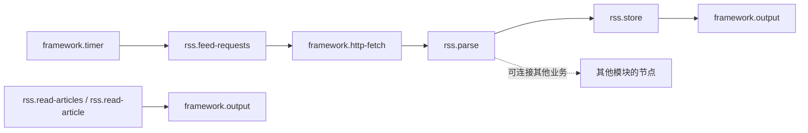

# 流式管线与 RSS 示例

[English](streaming-mvp.en.md) | 中文

## 目标与边界

这个版本用 RSS 阅读器探索可跨业务连接的流式节点框架。框架与业务分别编译，Schema 只服务当前实现，不引入额外的数据库设计标准。当前通过 CLI、进程内 API 和生成的 HTTP 客户端交互，尚未提供 ComfyUI 式的可视化编辑器。

## 框架与业务

| 部分 | 责任 |
| - | - |
| [Framework](../../src/LazyTuiHub.Framework/) | 数据引用、数据关联、管线定义、节点注册、有界队列、运行与取消；提供定时器、HTTP fetch 和输出节点。 |
| [RSS](../../src/LazyTuiHub.Rss/) | 订阅、RSS 2.0/Atom 解析、文章存储、查询与已读状态；通过节点注册接入框架。 |
| [Host](../../src/LazyTuiHub/) | 组合模块、CLI、后台抓取和协议适配。应用服务通过管线执行业务操作。 |
| [API](../../src/LazyTuiHub.Api/Protos/lazytuihub/rss/v1/rss_service.proto) | Proto 描述接口及其行为，生成 OpenAPI、HTTP 客户端和英文参考文档。 |

框架维护两类关系。PipelineDefinition 中的节点和连接表示处理关系；DataReference 与 DataRelation 表示持久数据之间的关联。RSS 将订阅、文章分别注册为 rss.feed、rss.article 数据对象，通过 contains 关联连接。业务字段保存在 RSS 自己的表中；文章写入和通用数据关联在同一 SQLite 事务中提交。数据目录不保存全部运行事件或载荷副本。

## 抓取与阅读



rss.ingest 是抓取图。rss.feeds、rss.articles、rss.article 是阅读图；订阅和标为已读也分别通过节点执行。HTTP 与本地调用共享 IRssApi 及应用服务，HTTP 边界进行必要的序列化；服务内部继续传递对象引用。具体字段、路由、分页、去重与错误语义见[生成的 API 参考](../api/index.md)。

## 流式执行

NodeRegistry 保存模块名称、输入/输出类型和执行函数。连接必须满足类型可赋值关系；源节点没有输入，转换与消费节点需要输入。运行前检查端点、连接、类型及 DAG，框架运行器不识别 RSS 类型。

每个节点拥有一个有界输入队列，默认容纳 16 条记录，可在图的 bufferCapacity 中调整。容量是缓冲资源设置，不限制业务条目总数。队列满时等待，压力向上游传播；广播向每个分支交付同一载荷引用，慢分支也会约束快分支。多个上游合流时，最后一个生产者结束后才关闭输入；不同上游之间不保证顺序，合流不执行 join。

借鉴 [Ray 的对象引用与不可变数据约定](https://docs.ray.io/en/latest/ray-core/objects.html)和 [Flink 的反压传播](https://nightlies.apache.org/flink/flink-docs-stable/docs/ops/monitoring/back_pressure/)，使用 [.NET Channels](https://learn.microsoft.com/en-us/dotnet/core/extensions/channels) 实现当前进程内管线。节点按只读约定共享载荷，转换节点产生新结果；GC 在所有使用者释放引用后回收对象。这不是跨进程共享内存或分布式对象存储。

HTTP fetch 将一份响应缓存在内存中，解析器逐条读取 XML，文章继续逐条传输、入库。XML 声明的编码由 XmlReader 处理，DTD 与外部实体被禁用。队列限制记录数量，不建立整个进程的字节预算；HTTP 缓冲、解析和 SQLite 仍有各自的分配与运行成本。Microsoft.Data.Sqlite 的 I/O 是同步的，节点在工作线程中执行，未将其包装成虚假的异步数据库 I/O。

节点出错会取消同次运行中的其他节点，等待退出后报告节点和原因。已提交的数据保留，不自动回滚全图，也不自动重试每个节点。后台抓取记录失败，等待下一刷新周期后重新执行。连续定时器立即触发一次，再按周期触发；积压时采用 PeriodicTimer 的合并行为，不承诺重放每个错过的时刻。

## 运行示例

先运行完全本地、临时数据的示例：

```sh
mise run demo:rss
mise run test
```

demo:rss 自建 RSS fixture、临时 SQLite 和 HTTP 服务，验证本地与 HTTP 结果、重复抓取、已读状态，以及从解析节点分出的另一个业务模块消费者，结束后删除自己创建的临时目录。产品测试另行覆盖反压、共享引用、合流结束、失败取消、XML、分页与重启。

使用持久工作区运行 CLI；下面的 URI 需要替换成实际 RSS 地址：

```sh
mise run run -- --rss help
mise run run -- --database ./artifacts/rss/workspace.db --rss add --feed-url https://example.com/feed.xml --title Example
mise run run -- --database ./artifacts/rss/workspace.db --rss feeds
mise run run -- --database ./artifacts/rss/workspace.db --rss refresh --name feeds/FEED_ID
mise run run -- --database ./artifacts/rss/workspace.db --rss articles --unread true
mise run run -- --database ./artifacts/rss/workspace.db --rss read --name feeds/FEED_ID/articles/ARTICLE_ID
```

add 返回订阅名称，articles 返回文章名称和后续分页 token；传入 --page-token 继续阅读下一页。read 返回文章并标为已读。CLI 使用 Proto JSON 输出内容，不执行条目中的 HTML。

不传 --database 时，工作区位于系统 LocalApplicationData 下的 LazyTuiHub/workspace.db。启动 HTTP 服务会同时启动后台抓取，首次创建抓取图时默认周期为 15 分钟，可用 --refresh-interval 00:05:00 指定。已有图不会被启动时的默认定义覆盖。

```sh
mise run run -- --database ./artifacts/rss/workspace.db --urls http://127.0.0.1:5080
```

## 调整管线与接入模块

查看节点类型与持久图：

```sh
mise run run -- --database ./artifacts/rss/workspace.db --rss nodes
mise run run -- --database ./artifacts/rss/workspace.db --rss pipeline --pipeline-name rss.ingest
```

将 pipeline 输出的 JSON 保存为文件，修改 nodes、edges 或 settings，再通过以下命令运行或保存。run 执行一次，watch 连续运行，Ctrl+C 取消。save-pipeline 验证图后按 name 替换定义；正在执行的图保留自己的快照，下次执行读取新定义。

```sh
mise run run -- --database ./artifacts/rss/workspace.db --rss run --pipeline-file ./pipeline.json
mise run run -- --database ./artifacts/rss/workspace.db --rss watch --pipeline-file ./pipeline.json
mise run run -- --database ./artifacts/rss/workspace.db --rss save-pipeline --pipeline-file ./pipeline.json
mise run run -- --database ./artifacts/rss/workspace.db --rss relations --feed-id FEED_ID
```

业务模块用 RegisterSource、RegisterTransform、RegisterSink 注册有类型的功能，再把节点实例连接进图。不需要修改 PipelineRunner。RssDemo 演示 demo.headlines 节点从 rss.parse 接收 ArticleDraft，原来的存储分支继续工作；PipelineTests 同时验证通用 object 节点能够接收业务载荷而不复制载荷。

## 当前实现范围

这是单进程、单个 SQLite 工作区的探索版本：没有分布式调度、检查点、崩溃后续跑、事件时间窗口、动态插件隔离或恰好执行一次保证；保存的图不保存运行中的队列。RSS 解析覆盖常见 RSS 2.0 与 Atom 形式，尚未覆盖所有扩展与 xml:base 规则。数据库当前按需创建表，尚未承诺历史 Schema 的升级兼容。

公网身份与权限尚未接入，示例只面向可信操作者；订阅 URI 让服务主动访问网络。HTTP 错误暂用 ASP.NET Core 原生的 google.rpc.Status JSON 和 ErrorInfo，尚未适配 AIP-193 的外层 error 与 HTTP code 表示；这是当前协议适配的明确差异，Google 静态检查不验证它。分页密钥保存在数据库同级 keys 目录，保留它才能让已有 token 在重启后继续使用。这些内容随实际业务需求继续细化，不构成本次数据库规范化要求。
